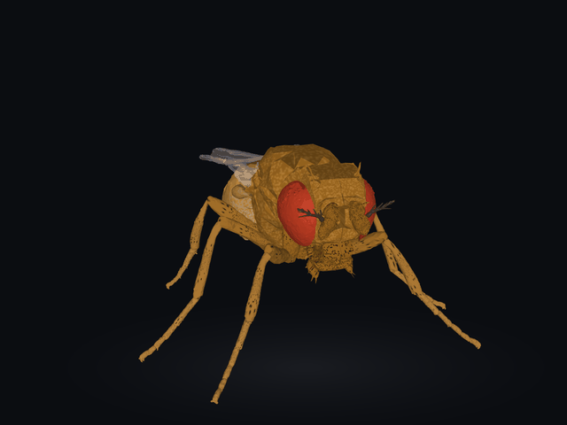

# I Believe I Am Fly

A fruit fly brain, simulated neuron by neuron, that reads handwritten digits and turns your
webcam gestures into the movements of a 3D fly.



The brain is wired exactly like a real *Drosophila* brain: 138,639 neurons and 15 million
connections, taken from the [FlyWire](https://flywire.ai/) connectome. We never change that
wiring. We only show the brain a picture, let its neurons fire, and train a small decoder that
reads the answer from their activity. This trick is called **reservoir computing**.

It was made for a high-school lecture: one computer runs the app, and every student's phone or
laptop runs its own copy of the brain right in the browser. A slide deck with live demos is
included.

## What you can do

- **Draw a digit** and watch it travel through the brain: every spike lights up in a 3D map of
  all 138k neurons, and each brain region "votes" for the digit it thinks it saw.
- **Control a fly with gestures.** Record a gesture for each fly action (raise a leg, flap the
  wings, wiggle the antennae, ...), train, and go live: your camera feeds the fly's eyes, the brain
  responds, and the fly moves. With the **Stick figure** input the fly sees a stick figure of your
  pose instead of the camera picture; it works out of the box, for anyone, in any room (see below).
- **Do brain surgery.** Silence whole regions, single cell types (`LPLC2`, `Tm*`, ...) or cut the
  brain in half, then see what still works.

## How it works

```
camera / drawing ──► fly's eyes ──► 138k spiking neurons ──► spike counts ──► small decoder ──► digit or fly action
                                    (real wiring, fixed)                     (the only part we train)
```

- **The brain** is the leaky integrate-and-fire model of
  [Shiu et al., Nature 2024](https://www.nature.com/articles/s41586-024-07763-9), via
  [eonsystemspbc/fly-brain](https://github.com/eonsystemspbc/fly-brain). There is a Python version
  for training and a JavaScript version that runs in the browser; they produce the same spikes.
- **The eyes:** each image is shown to the fly's visual neurons, brighter pixels making them fire
  faster.
- **The decoder** is a logistic regression on the spike counts of one brain region. The neurons
  that receive the image are left out, so the answer has to travel through real synapses.
- **The body** is [NeuroMechFly](https://neuromechfly.org/), a physics model of the fly. The
  server simulates it with MuJoCo; the static web version animates the same poses without physics.

## Stick-figure input

The camera tab has a switch, **Camera picture | Stick figure** (stick figure is the default; the
choice is kept per device). A camera-picture decoder only works in the room and for the people it
was recorded with. With **Stick figure**, MediaPipe finds the
person's shoulders, arms and hands in the browser, and the fly's eyes get a 48×36 drawing of that
pose ([skeleton.js](flymnist/static/skeleton.js)), so background, clothes and light no longer matter.

- **Out of the box** it uses decoders pre-trained on stick figures of HaGRIDv2 people
  (`data/pretrained_skeleton.joblib`, made by `uv run main.py pretrain --step skeleton`): hands down
  (rest), right hand up, left hand up, both hands up and a hand heart (flap wings). Press
  **Start live**; no recording needed. Whole brain: ~98% on people it never saw (both hands must be
  visible for the heart).
- **Train** mixes a fixed subset of the pre-trained examples (600 per gesture) with the class's
  stick-figure recordings and your own, your frames weighing more, so ~30 frames (one 4 s recording)
  teach a new gesture for any action. Your own gestures work best for you (other people's carry over
  only partly), so pick gestures that differ in arm position. Training takes ~6–15 s on the server.
- Stick-figure recordings are kept apart from camera-picture ones: the teacher's go to
  `data/skeleton_session.joblib`, students' to `data/sessions/skeleton/`. Each frame also keeps its
  body landmarks, so recordings are redrawn automatically when the stick-figure drawing changes.
- The static site ships the pre-trained decoders and a compact subset of the examples
  (`stick-train.json`: 200 per gesture, ~2,900 neurons, a few MB) to train in the browser.
- **Privacy:** the camera picture never leaves the device; only the drawing, its spike counts and the
  landmarks are stored. The MediaPipe library may send anonymous usage statistics to Google.

## Quick start

You need [uv](https://docs.astral.sh/uv/) (it installs Python and everything else):

```bash
# macOS / Linux
curl -LsSf https://astral.sh/uv/install.sh | sh
# Windows (PowerShell)
powershell -ExecutionPolicy ByPass -c "irm https://astral.sh/uv/install.ps1 | iex"
```

Then, in the project folder:

```bash
uv run main.py download                       # connectome, cell types and MNIST (~140 MB)
uv run main.py all --train 3000 --test 1000   # teach the digit decoders (~45 min on a laptop)
uv run main.py serve                          # start the app
```

`serve` prints the addresses to open, for example `http://127.0.0.1:8000` on this computer and
`https://<your IP>:8443` for other devices (the camera needs https). The page header shows a QR
code that students can scan.

Already trained on another computer? Copy the files instead of retraining (see
[Moving to another computer](#moving-to-another-computer)).

## Moving to another computer

Copy the project (without `.venv`) and these files from `data/`:

| File | What it is |
|---|---|
| `camera_session.joblib` | the class model (the teacher's gestures) |
| `skeleton_session.joblib`, `pretrained_skeleton.joblib` | the class's stick-figure recordings (if any) and the pre-trained stick-figure model |
| `spikes_lamina_500Hz_100ms.readouts.joblib` | the digit decoders (needed to start) |
| `spikes_lamina_500Hz_100ms.npz` | spike counts for **Test on 200 digits** |
| `2025_Connectivity_783.parquet`, `2025_Completeness_783.csv`, `neuron_annotations.tsv` | the connectome and cell types |
| `mnist/` | the digits |

To pack them into one zip (macOS / Linux):

```bash
zip -r data/fly-transfer-$(date +%Y%m%d).zip data/camera_session.joblib \
  data/spikes_lamina_500Hz_100ms.readouts.joblib data/spikes_lamina_500Hz_100ms.npz \
  data/2025_Connectivity_783.parquet data/2025_Completeness_783.csv data/neuron_annotations.tsv data/mnist
```

Unzip it in the project folder on the new computer (`tar -xf <file>.zip` on Windows) and run
`uv run main.py serve`.

**Back up the class model** before experimenting, because **Clear recordings** on the teacher's
computer deletes it:

```bash
cp data/camera_session.joblib data/backups/camera_session_$(date +%Y%m%d-%H%M%S).joblib
```

## Results

Digit recognition, 3,000 training and 1,000 test digits (chance = 10%):

| Decoder reads from | Real fly wiring | Randomly rewired brain |
|---|---|---|
| Raw pixels, no brain | 87.9% | 87.9% |
| Optic lobe | 90.9% | 90.2% |
| Central brain | 63.6% | 90.8% |
| Descending neurons (brain → body) | 62.2% | 87.0% |
| **Whole brain** | **91.1%** | **90.1%** |

- **The digit can be read from deep inside the brain**, even from the neurons that send commands
  to the body, four or more synapses away from the eyes.
- **The real wiring is no better at MNIST than random wiring.** The real brain keeps visual
  activity mostly in the optic lobes, while random wiring spreads it everywhere. That makes sense:
  reading digits isn't something a fly needs. Natural tasks show the wiring's purpose: a looming
  shadow makes the model's escape neuron fire at ~180 Hz while walking neurons stay silent.
- **Split brain:** cutting all left↔right connections barely matters for digits, because both
  eyes see the whole image. It does matter for escape: a looming shadow on the right eye no longer
  reaches the left escape neuron.

## Limitations

- The model has no background activity, so signals fade with depth. To reach the central brain,
  the eyes are driven harder than in a real fly.
- The image-to-eye mapping is approximate, and the model sees still frames, while real fly eyes
  are tuned to motion.
- Gestures are a learned mapping: a real fly doesn't raise a leg when it sees a hand.
- Simulation is slow (~0.2–0.4 s per image on a laptop), so only a few thousand digits are used.

## Project layout

| Path | What's inside |
|---|---|
| [main.py](main.py) | the command line |
| [flymnist/brain.py](flymnist/brain.py), [retina.py](flymnist/retina.py), [simulate.py](flymnist/simulate.py) | the brain, the eyes, running digits through them |
| [flymnist/readout.py](flymnist/readout.py), [camera.py](flymnist/camera.py) | digit decoders, camera frames and gesture decoders |
| [flymnist/stick.py](flymnist/stick.py), [skeleton.py](flymnist/skeleton.py) | the stick-figure input: drawing, pre-trained model, training |
| [flymnist/lesion.py](flymnist/lesion.py) | knockouts |
| [flymnist/body.py](flymnist/body.py), [poses.py](flymnist/poses.py) | the fly body (physics) and its poses for the browser |
| [flymnist/server.py](flymnist/server.py), [sessions.py](flymnist/sessions.py) | the web server, teacher and student sessions |
| [flymnist/site.py](flymnist/site.py) | builds the static website |
| [flymnist/static/](flymnist/static/) | the app (`index.html`), the browser brain (`brainsim.js`), the slides (`slides.html`, `slides/`) |

Commands (`uv run main.py <command>`):

| Command | What it does |
|---|---|
| `download` | fetch the connectome, cell types and MNIST into `data/` |
| `simulate`, `train`, `all` | run digits through the brain, train the decoders, or both (`--train`, `--test` = how many digits) |
| `serve` | start the app (`--port`, `--https-port`, `--host 127.0.0.1` for this computer only) |
| `site` | build the static website into `site/` |
| `poses` | re-export the fly's poses for the browser |
| `hemispheres` | left / right / both-hemisphere decoders (add `--split` for the cut brain) |

## Credits and license

- **Connectome:** FlyWire v783, Dorkenwald et al. 2024 and Schlegel et al. 2024
  ([flywire.ai](https://flywire.ai/)), CC BY-NC 4.0.
- **Brain model:** Shiu et al. 2024 ([code, MIT](https://github.com/philshiu/Drosophila_brain_model)),
  via [eonsystemspbc/fly-brain](https://github.com/eonsystemspbc/fly-brain) (GPL-2.0-or-later).
- **Fly body:** NeuroMechFly, Lobato-Rios et al. 2022 and Wang-Chen et al. 2024
  ([flygym](https://github.com/NeLy-EPFL/flygym), Apache-2.0).
- **Digits:** MNIST, LeCun, Cortes and Burges, CC BY-SA 3.0. **3D:** [three.js](https://threejs.org/), MIT.
- **Gestures for the stick-figure input:** HaGRIDv2, Kapitanov et al.,
  [arXiv:2412.01508](https://arxiv.org/abs/2412.01508), CC BY-SA 4.0 (research / non-commercial use
  per its authors). No photos are included: only stick figures drawn from body landmarks, their spike
  counts and decoders trained on them, shared under the same license.
- **Pose tracking:** [MediaPipe](https://github.com/google-ai-edge/mediapipe), Google, Apache-2.0
  (loaded from a CDN; it may send anonymous usage statistics to Google, never your pictures).
- The slides embed two YouTube shorts, credited to their creators under each video.

The same list is on the app's **Credits** page.

© 2026 Oleh Kovalyshyn. This project is free software under the **GNU GPL v2.0 or later** (see
[LICENSE](LICENSE)), provided without any warranty. Because it includes FlyWire data, which is
licensed for non-commercial use only, the app and copies of it must stay non-commercial.
